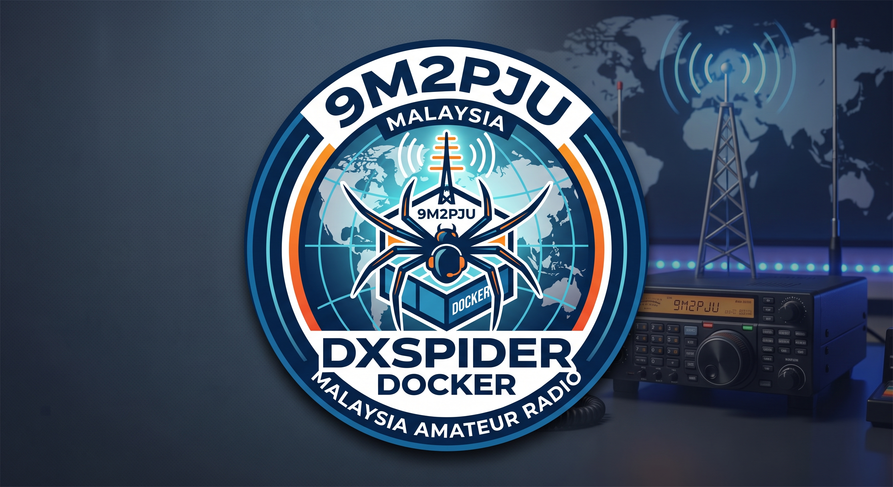
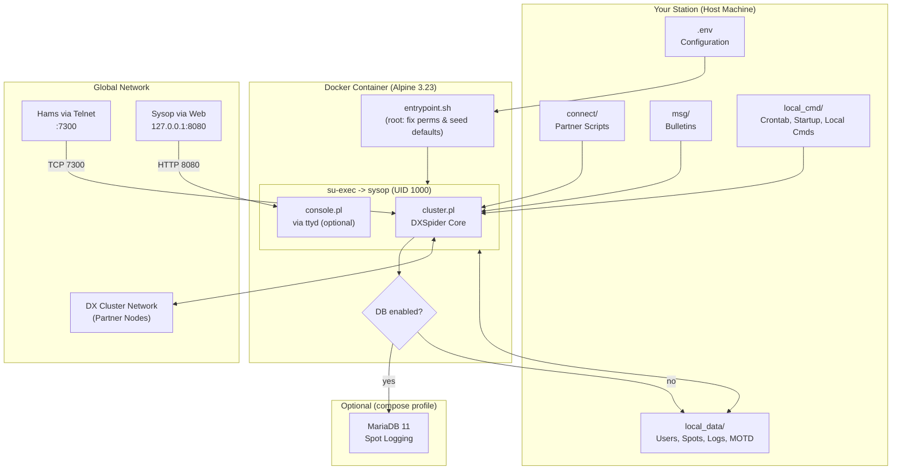

<div align="center">


# 9M2PJU DXSpider Docker
### The **Ultimate** Modern DX Cluster Solution

[](LICENSE)
[](https://github.com/9M2PJU/9M2PJU-DXSpider-Docker/issues)
[](https://github.com/9M2PJU/9M2PJU-DXSpider-Docker/pulls)
[](https://github.com/9M2PJU/9M2PJU-DXSpider-Docker/commits/main)
<br/>
[](https://github.com/9M2PJU/9M2PJU-DXSpider-Docker/stargazers)
[](https://github.com/9M2PJU/9M2PJU-DXSpider-Docker/network/members)
[](https://github.com/9M2PJU/9M2PJU-DXSpider-Docker/graphs/contributors)
[](https://github.com/9M2PJU/9M2PJU-DXSpider-Docker/commits)
<br/>
[](https://github.com/9M2PJU/9M2PJU-DXSpider-Docker/pkgs/container/9m2pju-dxspider-docker)
[](https://github.com/9M2PJU/9M2PJU-DXSpider-Docker/actions/workflows/docker-publish.yml)
[](#multi-architecture-support)
<br/>
[](https://github.com/9M2PJU/9M2PJU-DXSpider-Docker)
[](https://www.perl.org/)
[](https://alpinelinux.org/)
[-00a86b?style=for-the-badge)](https://github.com/EA3CV/dxspider)
[](Dockerfile)
[](#security--hardening)

<br/>

**Experience the future of Amateur Radio Networking.**
*Deploy a professional-grade DX Cluster node in minutes, not hours.*

[What is this?](#what-is-a-dx-cluster) &bull; [Quick Start](#quick-start) &bull; [Upgrading](#upgrading) &bull; [Documentation](#documentation) &bull; [Configuration](#configuration-reference) &bull; [Architecture](#architecture--flow) &bull; [Security](#security--hardening) &bull; [FAQ](#troubleshooting--faq)

</div>

---

## What is a DX Cluster?

A **DX Cluster** is a network of servers that share real-time "spots", reports of rare or interesting amateur radio stations heard on the air. When someone hears a DX station, they post a spot to their local cluster node, which then propagates it to all connected nodes worldwide within seconds.

**DXSpider** is the software that runs most of these cluster nodes. Originally created in the late 1990s and written in Perl, it has been actively maintained and extended by the amateur radio community for decades. This project packages DXSpider into a Docker container so you can deploy it without manually installing Perl, CPAN modules, or configuring a server.

---

## Key Features

| Feature | Description |
| :--- | :--- |
| **Instant Launch** | Interactive one-liner (`install.sh`) auto-generates a strong password, configures `.env`, and launches your node in minutes. |
| **Safe Upgrades** | Bundled `./upgrade.sh` script pre-pulls images, flushes SQLite cleanly, takes a quiescent backup, and verifies health. |
| **Web Console** | Optional web terminal (`ttyd`) bound to `127.0.0.1` by default with HTTP basic auth (or disable via `ENABLE_WEB_CONSOLE=no`). |
| **Hardened** | `cap_drop: ALL` + `no-new-privileges`, non-root `sysop` execution, and graceful `SIGTERM` flushing without needing `CAP_KILL`. |
| **Data Safety** | SQLite user database (`dxusers.db`), spots, logs, and auto-seeded configs live in 4 gitignored bind mounts; `create_sysop.pl` is skipped on restarts and upgrades. |
| **Full Mojo Parity** | Pinned to DXSpider Mojo `v1.57 build 933` (`b9bc2369`) with all 23 required Perl modules verified at build time. |
| **Universal** | Multi-arch images: amd64, arm64, arm/v7, arm/v6, 386, ppc64le, s390x, from servers to Raspberry Pi Zero. |
| **Automation** | Built-in Cron (atomic hourly blocklist updates + daily debug log cleanup) and Startup script support. |
| **Optional DB** | Flat-file + SQLite storage by default; optional MariaDB 11 backend via compose profile (`with-db`). |
| **CI Tested** | Every push and PR runs a 6-stage smoke test (telnet `sh/version`, HTTP auth, graceful stop, upgrade persistence) plus monthly Alpine security rebuilds. |

---

## Documentation

This project includes a complete `docs/` directory with beginner-friendly guides:

| Document | What it covers |
| :--- | :--- |
| [Getting Started](docs/01-getting-started.md) | Installation, first run, your first spot, basic commands |
| [Configuration Reference](docs/02-configuration.md) | All environment variables and DXVars.pm explained |
| [Connecting to Partner Nodes](docs/03-connecting-to-partners.md) | Joining the global DX Cluster network |
| [Filters](docs/04-filters.md) | Controlling what spots and announcements you see |
| [User Commands Reference](docs/05-user-commands.md) | Full command list for users and sysops |
| [Cron & Automation](docs/06-cron-and-automation.md) | Scheduled tasks, auto-reconnect, startup scripts |
| [Database Backend](docs/07-database-backend.md) | Optional MariaDB setup for spot logging |
| [Security](docs/08-security.md) | Hardening guide, capabilities, best practices |
| [Cloud Deployment](docs/09-cloud-deployment.md) | AWS, GCP, Azure, VPS, reverse proxy, and monitoring |
| [Troubleshooting](docs/10-troubleshooting.md) | FAQ, debugging, common problems and solutions |

> **New to DX Clusters?** Start with [Getting Started](docs/01-getting-started.md). It walks you through everything step by step.

---

## Architecture & Flow



---

## Quick Start

### Prerequisites

- **Linux**: [Docker & Docker Compose](https://docs.docker.com/get-docker/)
- **macOS**: [Docker Desktop](https://docs.docker.com/desktop/mac/)
- **Windows**: [Docker Desktop](https://docs.docker.com/desktop/windows/) with the WSL2 backend and WSL integration enabled
- **An amateur radio callsign**: needed to identify your node
- **Your Maidenhead grid square**: find it at https://grid.radio/

### Option A: Interactive Setup (Recommended)

The easiest way to get started is using our interactive installation script. It checks dependencies, clones the repository, prompts for your callsign, locator, QTH, and email, auto-generates a strong random Web Console password, locks down `.env` (`chmod 600`), and launches the cluster automatically.

```bash
curl -sSL https://raw.githubusercontent.com/9M2PJU/9M2PJU-DXSpider-Docker/main/install.sh | bash
```

### Option B: Manual Setup

> [!NOTE]
> This guide uses `docker compose` (Docker Compose V2) which is the recommended method to manage the container and its configuration.

> - If you prefer not to use Compose at all, you can use standard `docker` commands. See the **Standalone Docker Run** section below.

**1. Get the Code**
```bash
git clone https://github.com/9M2PJU/9M2PJU-DXSpider-Docker.git
cd 9M2PJU-DXSpider-Docker
```

**2. Configure Identity**

> [!IMPORTANT]
> After cloning this repository, **make sure all configurations are correct** in your `.env` file before starting the cluster. An incorrectly configured node can cause routing loops or be rejected by the DXSpider network.

```bash
cp .env.example .env
vi .env
# At minimum, set:
#   CLUSTER_CALLSIGN=YOURCALL-2
#   CLUSTER_SYSOP_CALLSIGN=YOURCALL
#   CLUSTER_LOCATOR=YOURGRID
#   WEB_PASS=a-secure-password
```

**3. Pull & Launch!**
```bash
docker compose pull      # Download the pre-built image from GHCR (fast)
docker compose up -d     # Start the cluster
```

> [!TIP]
> `docker compose pull` downloads the pre-built multi-arch image from GitHub Container Registry. No local build is needed, and this is much faster than `--build`.
>
> If you prefer to build locally (e.g., offline or custom modifications), use `docker compose up -d --build` instead.

**You are live!** Access your node:
- **Telnet**: `telnet localhost 7300` (users connect here)
- **Web Console**: `http://127.0.0.1:8080` (use `WEB_USER` / `WEB_PASS` from `.env`; bound to localhost by default for security)

> [!WARNING]
> A standalone DXSpider node **will not receive any DX spots** on its own! To get spots flowing, you must connect your node to a partner node on the DX Cluster network. You will need to find a partner to connect to. See [Connecting to Partners](docs/03-connecting-to-partners.md) for instructions.

> [!IMPORTANT]
> The container runs as UID 1000 internally. If your host directories are owned by a different UID, either:
> - Change `SPIDER_UID` in `.env` to match your host UID, or
> - `chown -R 1000:1000 local_data local_cmd connect msg` on the host before starting.

### Your First Commands

Once connected via telnet, try these:

| Command | What it does |
| :--- | :--- |
| `help` | Show available commands |
| `sh/dx` | Show recent DX spots |
| `sh/dx 20m` | Show spots on the 20-meter band |
| `sh/configuration` | Show all connected nodes and users |
| `set/name Your Name` | Set your name |
| `set/homenode YOURCALL-2` | Set your home node |
| `bye` | Disconnect |

See the [User Commands Reference](docs/05-user-commands.md) for the full list.

> [!TIP]
> For a complete walkthrough including posting your first DX spot, see [Getting Started](docs/01-getting-started.md).

---

## Multi-Architecture Support

This project supports a wide range of CPU architectures, making it compatible with everything from high-end servers to Raspberry Pi Zero.

**Docker (Linux): Supported Platforms**
| Platform | Typical Hardware |
| :--- | :--- |
| `linux/amd64` | Standard 64-bit PC / servers |
| `linux/arm64` | Raspberry Pi 4/5, Apple Silicon, AWS Graviton |
| `linux/arm/v7` | Raspberry Pi 2/3 (32-bit) |
| `linux/arm/v6` | Raspberry Pi Zero/1 |
| `linux/386` | 32-bit x86 PCs / older servers |
| `linux/ppc64le` | IBM POWER servers |
| `linux/s390x` | IBM Z / LinuxONE mainframes |


Pre-built images are published automatically to GHCR on every push to `main` (tagged `:main`, `:latest`, and commit SHA) and rebuilt monthly for Alpine security updates:

```bash
docker pull ghcr.io/9m2pju/9m2pju-dxspider-docker:main
# or:
docker pull ghcr.io/9m2pju/9m2pju-dxspider-docker:latest
```

### Standalone Docker Run

If you prefer not to use Docker Compose, you can run the cluster with a single `docker run` command. This is useful for quick testing or cloud environments like AWS ECS or Azure ACI.

> [!IMPORTANT]
> Always mount **all** the bind volumes shown below. Without them, your connect scripts, crontab, startup commands, MOTD, and data will be lost when the container is recreated or the image is updated.

```bash
docker run -d \
  --name dxspider \
  -p 7300:7300 \
  -p 127.0.0.1:8080:8080 \
  -e CLUSTER_CALLSIGN=N0CALL-2 \
  -e CLUSTER_SYSOP_CALLSIGN=9M2PJU \
  -e CLUSTER_LOCATOR=OJ03UD \
  -e CLUSTER_LATITUDE=+03.08 \
  -e CLUSTER_LONGITUDE=+101.41 \
  -e CLUSTER_QTH="Kuala Lumpur" \
  -e CLUSTER_SYSOP_EMAIL="sysop@example.org" \
  -e WEB_USER=sysop \
  -e WEB_PASS=your-secure-password \
  -v $(pwd)/local_data:/spider/local_data \
  -v $(pwd)/local_cmd:/spider/local_cmd \
  -v $(pwd)/connect:/spider/connect \
  -v $(pwd)/msg:/spider/msg \
  ghcr.io/9m2pju/9m2pju-dxspider-docker:main
```

> [!TIP]
> **Persistent Data**: Always mount all four directories above. On first start, `entrypoint.sh` automatically seeds `local_cmd/crontab`, `local_cmd/startup`, `local_data/motd`, and `local_data/motd_nor` from templates (using your callsign, QTH, and email) without ever overwriting your existing files.

### Manual Multi-Arch Build (Advanced)

> [!NOTE]
> This is **optional**. Our GitHub Actions automatically build and push these images for you. Use this only if you want to build a custom version locally.

```bash
docker buildx build \
  --platform linux/amd64,linux/arm64,linux/arm/v7,linux/arm/v6,linux/386,linux/ppc64le,linux/s390x \
  -t ghcr.io/9m2pju/9m2pju-dxspider-docker:latest \
  --push .
```

To pin DXSpider to a specific commit (for reproducible builds):

```bash
docker buildx build \
  --build-arg SPIDER_GIT_REF=<commit-sha> \
  -t dxspider-custom:latest \
  --load .
```

---

## Configuration Reference

Edit these in your `.env` file (copy from `.env.example`). All variables have sensible defaults. Only `CLUSTER_CALLSIGN` and `CLUSTER_SYSOP_CALLSIGN` are truly required.

> For a complete explanation of every variable and how configuration works, see the [Configuration Reference](docs/02-configuration.md).

### Identity & Sysop

| Variable | Description | Default |
| :--- | :--- | :--- |
| `CLUSTER_CALLSIGN` | **Required**. The callsign of your node. | `N0CALL-2` |
| `CLUSTER_SYSOP_CALLSIGN` | **Required**. Your admin callsign. | `9M2PJU` |
| `CLUSTER_SYSOP_NAME` | Sysop's display name. | `DXSpider Sysop` |
| `CLUSTER_SYSOP_EMAIL` | Sysop contact email. | `9m2pju@hamradio.my` |
| `CLUSTER_SYSOP_BBS_ADDRESS` | BBS forwarding address. | `bbs@localhost` |
| `CLUSTER_QTH` | Your QTH description. | `DXSpider Node` |
| `CLUSTER_LOCATOR` | Maidenhead grid square. | `JO01aa` |
| `CLUSTER_LATITUDE` | Latitude (decimal degrees). | `0` |
| `CLUSTER_LONGITUDE` | Longitude (decimal degrees). | `0` |

### Network

| Variable | Description | Default |
| :--- | :--- | :--- |
| `CLUSTER_PORT` | Telnet port (user-facing). | `7300` |
| `CLUSTER_SYSOP_PORT` | Web Console port (ttyd). | `8080` |

### Web Console

| Variable | Description | Default |
| :--- | :--- | :--- |
| `ENABLE_WEB_CONSOLE` | Enable or disable the `ttyd` Web Console (`yes` or `no`). | `yes` |
| `WEB_BIND_ADDRESS` | Host IP to bind the Web Console port (`127.0.0.1` for localhost/SSH tunnel, or `0.0.0.0` behind a firewall). | `127.0.0.1` |
| `WEB_USER` | Username for the Web Console (HTTP basic auth). | `sysop` |
| `WEB_PASS` | Password for the Web Console (`install.sh` auto-generates a strong password). | `changeme-web` |

### Optional MariaDB Backend

Leave `CLUSTER_DB_HOSTNAME` empty (default) to use flat-file storage. To enable MariaDB for spot logging:

| Variable | Description | Default |
| :--- | :--- | :--- |
| `CLUSTER_DB_HOSTNAME` | Database hostname. Set to `db` to use the compose service. | *(empty = disabled)* |
| `CLUSTER_DB_NAME` | Database name. | `spider` |
| `CLUSTER_DB_USER` | Database username. | `sysop` |
| `CLUSTER_DB_PASS` | Database password. | `sysoppassword` |
| `CLUSTER_DB_PORT` | Database port. | `3306` |
| `CLUSTER_DB_ROOT_PWD` | MariaDB root password (compose `db` service only). | `changeme-root` |

```bash
# Enable MariaDB:
# 1. Uncomment the DB lines in .env
# 2. Start with the with-db profile:
docker compose --profile with-db up -d
```

> See [Database Backend](docs/07-database-backend.md) for full setup instructions.

### Build & Advanced

| Variable | Description | Default |
| :--- | :--- | :--- |
| `CLUSTER_DXSPIDER_BRANCH` | DXSpider git branch (`mojo` or `master`). | `mojo` |
| `SPIDER_GIT_REF` | Pin DXSpider to a specific commit SHA. | `b9bc2369` (`v1.57 build 933`) |
| `SPIDER_UID` | UID for the sysop user inside the container. | `1000` |
| `OVERWRITE_CONFIG` | Set to `yes` to force-regenerate `DXVars.pm` and `Listeners.pm` on every start. | `no` |

---

## Security & Hardening

This container follows security best practices:

| Measure | How |
| :--- | :--- |
| **No privileged mode** | `privileged: true` is **not** used. The container runs with normal Docker isolation. |
| **Minimal capabilities** | `cap_drop: ALL` + only `CHOWN`, `DAC_OVERRIDE`, `FOWNER`, `SETUID`, `SETGID` added back. |
| **No new privileges** | `security_opt: no-new-privileges:true` prevents privilege escalation. |
| **Non-root application** | `cluster.pl` and `console.pl` run as the `sysop` user (UID 1000) via `su-exec`. |
| **Root only for setup** | The entrypoint starts as root only to fix volume permissions and seed defaults, then drops to `sysop`. |
| **Localhost Web Console** | `ttyd` binds to `127.0.0.1:8080` by default (`WEB_BIND_ADDRESS=127.0.0.1`) and can be disabled via `ENABLE_WEB_CONSOLE=no`. |
| **Graceful shutdown** | `tini` as PID 1 + `stop_grace_period: 30s` forwards `SIGTERM` to `cluster.pl` as `sysop` so SQLite flushes cleanly without `CAP_KILL`. |
| **No secrets in git** | `.env`, `local_data/`, `local_cmd/`, and custom `connect/` scripts are gitignored. Use `.env.example` and `defaults/` as templates. |

> For a full hardening guide including firewall setup, SSH tunneling, and abuse reporting, see [Security](docs/08-security.md).

---

## Persistence & Bind Mounts

All your node's configuration and data lives on the **host** filesystem, not inside the container. Docker bind mounts map host directories into the container, overriding the default files baked into the image. This means:

- **Rebuilding the image does NOT change your configuration.** Your host files always take precedence over the image's defaults.
- **Upgrading is safe.** Pull a new image, rebuild, and restart. Your connect scripts, crontab, startup commands, MOTD, user database, and spots are all preserved on the host.
- **Backups are easy.** Just back up the project directory (especially `local_data/`).

### What is persistent?

All four bind-mounted directories are gitignored for user data so `git pull` never conflicts with your node settings. On first boot, `entrypoint.sh` seeds `local_cmd/crontab`, `local_cmd/startup`, `local_data/motd`, and `local_data/motd_nor` from `defaults/` if absent.

| Host Directory | What's Stored There | Bind-Mounted? |
| :--- | :--- | :--- |
| `local_data/` | User database (`dxusers.db`), spots, logs, debug data, filter lists, `motd`, `motd_nor` | Yes |
| `local_cmd/` | Cron schedule (`crontab`), boot commands (`startup`), and local command overrides | Yes |
| `connect/` | Partner node connection scripts | Yes |
| `msg/` | Bulletins and private messages | Yes |

### What is NOT persistent (regenerated on each start)?

| File | Why |
| :--- | :--- |
| `/spider/local/DXVars.pm` | Generated by `entrypoint.sh` from `.env` variables |
| `/spider/local/Listeners.pm` | Generated by `entrypoint.sh` from `CLUSTER_PORT` |

If you need to persist these too (e.g., you manually edit `DXVars.pm` inside the container), set `OVERWRITE_CONFIG=no` in `.env` and add a bind mount for `./local:/spider/local:rw` in `compose.yaml`.

> [!TIP]
> To force-regenerate config from `.env` after changing variables, set `OVERWRITE_CONFIG=yes` in `.env` and restart. Set it back to `no` afterward.

---

## Upgrading

Because your user database, spots, logs, and node configuration are stored in host bind mounts, upgrading DXSpider is safe and preserves your station data.

> [!NOTE]
> **User database protection:** On startup, `entrypoint.sh` automatically detects existing user databases (`dxusers.db`, `users.v3j`, `users.v3`, or `users.v2`) and skips `create_sysop.pl`. User passwords, registrations, and attributes are never overwritten during upgrades.

### Option A: Automated Upgrade Script (Recommended)

Run the bundled `upgrade.sh` helper from your installation directory. It automatically migrates any legacy root-level config files, pulls updates, pre-pulls the image while the cluster stays online, stops `dxspider` cleanly to flush SQLite, creates a timestamped backup in the parent directory, recreates the container, and waits for a healthy status:

```bash
cd ~/9M2PJU-DXSpider-Docker
./upgrade.sh              # Standard GHCR image upgrade (auto-detects MariaDB if configured)
./upgrade.sh --build      # Build image locally (--no-cache) instead of pulling from GHCR
./upgrade.sh --with-db    # Explicitly include the optional MariaDB profile
```

### Option B: Manual Upgrade (Docker Compose + GHCR Image)

If you prefer running each step manually:

**1. Pull repository updates and check `.env` for new variables**

```bash
cd ~/9M2PJU-DXSpider-Docker
git pull
diff -u .env.example .env || true
```

*(If upgrading from an older checkout where `startup`, `motd`, `motd_nor`, or `local_cmd/crontab` were tracked in git, copy your customized files into `local_cmd/startup`, `local_data/motd`, `local_data/motd_nor`, and `local_cmd/crontab` or stash before `git pull`.)*

**2. Pre-pull the latest container image**

```bash
docker compose pull dxspider
```

*(If you use the optional MariaDB backend, pull both services with `docker compose --profile with-db pull`.)*

**3. Stop DXSpider cleanly and take a quiescent backup**

```bash
docker compose stop dxspider
tar czf "../dxspider-backup-$(date +%F).tar.gz" .env local_data/ connect/ local_cmd/ msg/
```

*(The archive is saved in the parent directory to keep your git working tree clean.)*

**4. Recreate and start the updated container**

For standard flat-file / SQLite storage (default):
```bash
docker compose up -d --no-deps dxspider
```

For installations using the optional MariaDB backend (`with-db` profile):
```bash
docker compose --profile with-db up -d
```

**5. Verify the upgrade**

```bash
docker compose ps                                 # Confirm status is Up (healthy)
docker compose logs --tail 50 dxspider            # Confirm clean boot with no Perl errors
docker compose exec dxspider cat /spider/.version # Verify installed DXSpider Mojo commit
```

Then connect via Telnet (`telnet localhost 7300`) or the Web Console (`http://127.0.0.1:8080`) and run `sh/version` and `sh/configuration` to confirm the build version and partner node links.

> [!TIP]
> Once everything is verified, you can remove old unused images to reclaim disk space: `docker image prune -f`.

### Upgrading with a Local Build (Custom or Pinned Commit)

If you build the image locally instead of pulling from GHCR (or want to pin a custom DXSpider commit):

```bash
git pull
docker compose build --no-cache dxspider
docker compose stop dxspider
tar czf "../dxspider-backup-$(date +%F).tar.gz" .env local_data/ connect/ local_cmd/ msg/
docker compose up -d --no-deps dxspider
docker compose exec dxspider cat /spider/.version
```

To build against a specific upstream DXSpider commit without editing `Dockerfile`, set `SPIDER_GIT_REF=<commit-sha>` in `.env` (or pass `--build-arg SPIDER_GIT_REF=<commit-sha>` to `docker compose build`).

### Upgrading a Standalone `docker run` Deployment

If you run the container directly with `docker run` instead of Docker Compose:

```bash
# 1. Pull the latest image
docker pull ghcr.io/9m2pju/9m2pju-dxspider-docker:main

# 2. Stop the running container cleanly and back up your data
docker stop dxspider
tar czf "../dxspider-backup-$(date +%F).tar.gz" local_data/ connect/ local_cmd/ msg/

# 3. Remove the old container (your host bind mounts remain untouched)
docker rm dxspider

# 4. Recreate the container using your original `docker run` command
#    (keep all -e environment variables and -v volume mounts identical)
```

Verify with `docker logs --tail 50 dxspider` and `docker exec dxspider cat /spider/.version`.

### Notes When Upgrading from Older Releases

- **User config templates (`startup`, `motd`, `motd_nor`, `local_cmd/crontab`):** Starter configs now live in `defaults/` and are automatically seeded on first boot into `local_cmd/startup`, `local_cmd/crontab`, `local_data/motd`, and `local_data/motd_nor` so `git pull` never conflicts. If you are upgrading from an older version with root-level `startup`, `motd`, or `motd_nor`, running `./upgrade.sh` migrates them automatically (or move them manually into `local_cmd/startup`, `local_data/motd`, and `local_data/motd_nor`).
- **Removal of `./cmd:/spider/cmd` bind mount:** Upstream DXSpider commands now come directly from the container image so upgrades always get the latest Mojo commands. Keep any custom commands in `local_cmd/`.
- **Web Console default bind (`127.0.0.1`):** For security, port `8080` now binds to `127.0.0.1` by default (`WEB_BIND_ADDRESS=127.0.0.1`). Access it via SSH tunnel or an HTTPS reverse proxy, or set `WEB_BIND_ADDRESS=0.0.0.0` in `.env` if you intentionally expose it behind a firewall. Set `ENABLE_WEB_CONSOLE=no` to disable `ttyd` completely.
- **Docker Compose V1 (`docker-compose.yml`) to Compose V2 (`compose.yaml`):** Older checkouts used `docker-compose.yml` and `docker-compose`. This repository now uses `compose.yaml` with `docker compose` (Docker Compose v2.20+ is required for `depends_on.db.required: false`). If an old `docker-compose.yml` still exists in your directory, migrate any custom edits into `compose.yaml` and remove `docker-compose.yml`.
- **`DAC_OVERRIDE` capability:** Newer images require `DAC_OVERRIDE` under `cap_add` in `compose.yaml` so `entrypoint.sh` can manage permissions on sysop-owned bind mounts. Pulling the latest `compose.yaml` applies this automatically; if you maintain a custom compose file, ensure `DAC_OVERRIDE` is listed in `cap_add`.
- **SQLite user database (`dxusers.db`):** Newer DXSpider Mojo builds require `our $userdsn` in `/spider/local/DXVars.pm`. Even if you bind-mount `./local:/spider/local` with `OVERWRITE_CONFIG=no`, `entrypoint.sh` automatically appends `$userdsn` if missing.

### Rolling Back an Upgrade

If an upgrade causes unexpected issues:

1. **Stop the container:**
   ```bash
   docker compose stop dxspider
   ```
2. **Restore your backup** (if user data or configs were affected):
   ```bash
   tar xzf ../dxspider-backup-YYYY-MM-DD.tar.gz
   ```
3. **Switch back to the previous version:**
   - **Pre-built GHCR image:** Pin a previous image tag or digest in `compose.yaml` (see available tags on the [GHCR packages page](https://github.com/9M2PJU/9M2PJU-DXSpider-Docker/pkgs/container/9m2pju-dxspider-docker)), then run `docker compose pull dxspider && docker compose up -d --no-deps dxspider`.
   - **Local build:** Check out the previous git commit (`git log -n 5 --oneline` then `git checkout <previous-commit>`), rebuild with `docker compose build --no-cache dxspider`, and start with `docker compose up -d --no-deps dxspider`.

---

## Connecting to Partner Nodes

To join the global DX Cluster network, your node needs to link to at least one other node. This is both a **technical** and **social** process. You need the other sysop's permission.

> [!IMPORTANT]
> **You cannot simply connect to any node without permission.** Contact the sysop of the node you want to link with, agree on a password, and then configure your connect script.

Quick steps:
1. Create a file in `connect/` named after the partner node (lowercase), e.g., `connect/gb7mbc`
2. Add the connection logic (telnet hostname, port, login, password)
3. Mark the partner as a node: `set/spider gb7mbc`
4. Connect: `connect gb7mbc`
5. Add auto-reconnect to `local_cmd/crontab`

> See [Connecting to Partner Nodes](docs/03-connecting-to-partners.md) for the complete guide.

---

## Automation (Cron & Startup)

**Startup Tasks**: Edit `local_cmd/startup` (seeded automatically on first boot). Commands here run every time the container boots:
```bash
# Example 'local_cmd/startup' file content:
load/forward
set/spider gb7mbc
connect gb7mbc
```

**Scheduled Tasks (Cron)**: Edit `local_cmd/crontab` (seeded automatically on first boot). Standard cron format, but commands are Perl expressions:
```bash
# Reconnect to GB7MBC every 10 mins if link dropped
0,10,20,30,40,50 * * * * start_connect('gb7mbc') unless connected('gb7mbc')
```

The default crontab also fetches bad-IP, bad-DX, bad-spotter, bad-node, and bad-word lists atomically every hour from the [dxspider_info repo](https://github.com/EA3CV/dxspider_info) and cleans old debug logs daily (`DXDebug::dbgclean()`).

> See [Cron & Automation](docs/06-cron-and-automation.md) for the complete guide.


---

## Windows Support

Windows users can run 9M2PJU DXSpider Docker easily using WSL2 or traditional virtualization.

### WSL2 (Recommended)
1. Install **Docker Desktop** and enable the **WSL2 Backend**.
2. Install a Linux distribution (e.g., Ubuntu) from the Microsoft Store.
3. In Docker Desktop, enable **Settings > Resources > WSL Integration** for that distribution.
4. Open the distribution's WSL terminal and run the [Interactive Setup command above](#option-a-interactive-setup-recommended).
5. Keep the installation inside the WSL2 filesystem (`~/dxspider`) rather than on the Windows C: drive.

### Hyper-V
1. Enable the **Hyper-V** feature in Windows.
2. Create a Linux Virtual Machine.
3. Install Docker and follow the standard Linux instructions.

---

## Troubleshooting & FAQ

<details>
<summary><b>My container keeps restarting!</b></summary>

Check the logs immediately:
```bash
docker compose logs -f
```
Common issues:
*   Invalid characters in `.env` (e.g., unquoted spaces in values).
*   Port 7300 is already in use by another application.
*   Bind-mounted directories owned by a UID other than 1000 (set `SPIDER_UID` to match, or `chown -R 1000:1000` the directories).
</details>

<details>
<summary><b>How do I access the internal shell?</b></summary>

If you need to run manual spider commands or debug internally:
```bash
docker compose exec dxspider sh
# Then run commands like:
/spider/perl/console.pl
```
</details>

<details>
<summary><b>How do I update to the latest version?</b></summary>

Run the automated upgrade script:
```bash
./upgrade.sh
```

Or run the manual sequence for Docker Compose:
```bash
git pull
docker compose pull dxspider
docker compose stop dxspider
tar czf "../dxspider-backup-$(date +%F).tar.gz" .env local_data/ connect/ local_cmd/ msg/
docker compose up -d --no-deps dxspider
docker compose exec dxspider cat /spider/.version
```
*Existing user databases (`dxusers.db` / `users.v3j`) are detected automatically: `create_sysop.pl` is skipped on updates so passwords and user attributes are never wiped.*

> See the full [Upgrading](#upgrading) section for MariaDB (`with-db`) upgrades, local builds, standalone `docker run`, older-release migration notes, and rollback steps.
</details>

<details>
<summary><b>Permission denied errors on volumes?</b></summary>

The container expects bind-mounted directories to be writable by UID 1000. Fix with:
```bash
chown -R 1000:1000 local_data local_cmd connect msg
```
Or set `SPIDER_UID` in `.env` to match your host user's UID.
</details>

<details>
<summary><b>How do I force-regenerate the configuration?</b></summary>

Set `OVERWRITE_CONFIG=yes` in your `.env` and recreate the `dxspider` container:
```bash
docker compose stop dxspider
docker compose up -d --no-deps dxspider
```
Set `OVERWRITE_CONFIG=no` afterward to preserve manual edits (especially if you bind-mount `./local:/spider/local`).
</details>

> For more troubleshooting, see the [Troubleshooting Guide](docs/10-troubleshooting.md).

---

## History & Legacy

To understand why this project exists, we must look back at the rich history of Amateur Radio networking.

### The Dawn: Packet Clusters
In the late 1980s, **PacketCluster** software revolutionized DX hunting. Before this, DX spots could only be shared via voice repeaters or local shouting. This software allowed spots to be distributed over **Packet Radio (AX.25)** networks. A "Sysop" would run a node, and users would connect via radio to see a live stream of DX spots.

### The Evolution: DXSpider
By the late 1990s, the internet was emerging, and the original DOS-based PacketCluster software was showing its age. A new, more flexible solution was needed to bridge the gap between RF networks and the Internet.

**Perl** was chosen for its robust text handling and modularity, and **DXSpider** was born. It was designed to be:
*   **Compatible**: It spoke the exact same protocol as the older software, so users didn't need to change their client software.
*   **Scalable**: It could handle hundreds of simultaneous internet connections, something the old PC-based clusters couldn't dream of.
*   **Open**: It allowed the community to contribute and extend the software.

Today, DXSpider powers a vast majority of the world's DX Cluster nodes, silently processing millions of spots a year and keeping the global amateur radio community connected. **9M2PJU-DXSpider-Docker** is simply the next step in this evolution, packaging this history into a container for the future.

---

## Contributing

We love community involvement!
1.  Fork it.
2.  Create your feature branch (`git checkout -b feature/cool-thing`).
3.  Commit your changes.
4.  Push to the branch.
5.  Create a Pull Request.

> [!TIP]
> Every PR is automatically verified by a 6-stage CI smoke test (fresh boot with hardened capabilities, Perl `DXVars.pm` syntax, live telnet `sh/version`, Web Console HTTP 401/200 auth, graceful shutdown + upgrade persistence, and `ENABLE_WEB_CONSOLE=no`) before images are published.

---

## License

Distributed under the GNU General Public License v3.0. See `LICENSE` for more information.

---

<div align="center">

**Enjoying the project?**
[Star us on GitHub!](https://github.com/9M2PJU/9M2PJU-DXSpider-Docker)

<br/>

### ☕ Support

If you find this project useful, you can support its development:

<a href="https://buymeacoffee.com/9m2pju"></a>
&nbsp;&nbsp;
<a href="https://wise.com/pay/me/faizulz13"></a>
&nbsp;&nbsp;
<a href="https://paypal.me/9M2PJU"></a>

<br/><br/>

📧 Contact: **9m2pju@hamradio.my** &nbsp;|&nbsp; 🌐 Website: **[hamradio.my](https://hamradio.my)**

<br/>

*Designed with care by **9M2PJU***
*73 and Good DX!*

</div>
