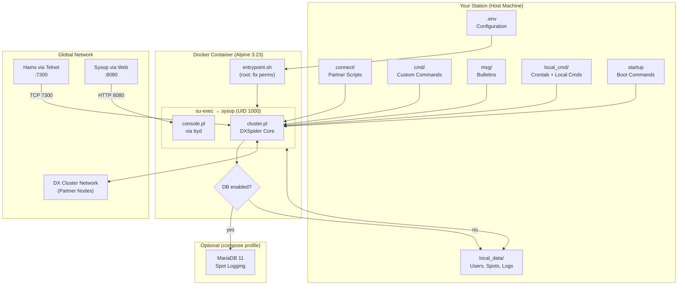

<div align="center">


# 9M2PJU DXSpider Docker
### The **Ultimate** Modern DX Cluster Solution

[](LICENSE)
[](https://github.com/9M2PJU/9M2PJU-DXSpider-Docker/issues)
[](https://github.com/9M2PJU/9M2PJU-DXSpider-Docker/pulls)
[](https://github.com/9M2PJU/9M2PJU-DXSpider-Docker/commits/main)
<br/>
[](https://github.com/9M2PJU/9M2PJU-DXSpider-Docker/stargazers)
[](https://github.com/9M2PJU/9M2PJU-DXSpider-Docker/network/members)
[](https://github.com/9M2PJU/9M2PJU-DXSpider-Docker/graphs/contributors)
[](https://github.com/9M2PJU/9M2PJU-DXSpider-Docker/commits)
<br/>
[](https://github.com/9M2PJU/9M2PJU-DXSpider-Docker/pkgs/container/9m2pju-dxspider-docker)
[](https://github.com/9M2PJU/9M2PJU-DXSpider-Docker/actions/workflows/docker-publish.yml)
[](#-multi-architecture-support)
<br/>
[](https://github.com/9M2PJU/9M2PJU-DXSpider-Docker)
[](https://www.perl.org/)
[](https://alpinelinux.org/)
[](#-security--hardening)

<br/>

**Experience the future of Amateur Radio Networking.**
*Deploy a professional-grade DX Cluster node in minutes, not hours.*

[What is this?](#-what-is-a-dx-cluster) &bull; [Quick Start](#-quick-start) &bull; [Documentation](#-documentation) &bull; [Configuration](#-configuration-reference) &bull; [Architecture](#-architecture--flow) &bull; [Security](#-security--hardening) &bull; [FAQ](#-troubleshooting--faq)

</div>

---

## What is a DX Cluster?

A **DX Cluster** is a network of servers that share real-time "spots", reports of rare or interesting amateur radio stations heard on the air. When someone hears a DX station, they post a spot to their local cluster node, which then propagates it to all connected nodes worldwide within seconds.

**DXSpider** is the software that runs most of these cluster nodes. Originally created in the late 1990s and written in Perl, it has been actively maintained and extended by the amateur radio community for decades. This project packages DXSpider into a Docker container so you can deploy it without manually installing Perl, CPAN modules, or configuring a server.

---

## Key Features

| Feature | Description |
| :--- | :--- |
| **Instant Launch** | Three lines of code and you are live. Literally. |
| **Web Console** | Built-in web terminal (`ttyd`) for easy administration without SSH. |
| **Hardened** | `cap_drop: ALL` + `no-new-privileges`, with only the minimal kernel capabilities needed. |
| **Data Safety** | User database, spots, and logs are safe in persistent bind-mounted volumes. |
| **Universal** | Multi-arch images: amd64, arm64, arm/v7, arm/v6, 386, ppc64le, s390x, from servers to Raspberry Pi Zero. |
| **Automation** | Built-in Cron and Startup script support. |
| **Optional DB** | Flat-file storage by default; optional MariaDB backend via compose profile. |
| **CI Tested** | Every commit is smoke-tested in GitHub Actions before publishing. |

---

## Documentation

This project includes a complete `docs/` directory with beginner-friendly guides:

| Document | What it covers |
| :--- | :--- |
| [Getting Started](docs/01-getting-started.md) | Installation, first run, your first spot, basic commands |
| [Configuration Reference](docs/02-configuration.md) | All environment variables and DXVars.pm explained |
| [Connecting to Partner Nodes](docs/03-connecting-to-partners.md) | Joining the global DX Cluster network |
| [Filters](docs/04-filters.md) | Controlling what spots and announcements you see |
| [User Commands Reference](docs/05-user-commands.md) | Full command list for users and sysops |
| [Cron & Automation](docs/06-cron-and-automation.md) | Scheduled tasks, auto-reconnect, startup scripts |
| [Database Backend](docs/07-database-backend.md) | Optional MariaDB setup for spot logging |
| [Security](docs/08-security.md) | Hardening guide, capabilities, best practices |
| [Cloud Deployment](docs/09-cloud-deployment.md) | AWS, GCP, Azure, DigitalOcean, Hetzner |
| [Troubleshooting](docs/10-troubleshooting.md) | FAQ, debugging, common problems and solutions |

> **New to DX Clusters?** Start with [Getting Started](docs/01-getting-started.md). It walks you through everything step by step.

---

## Architecture & Flow



---

## Quick Start

### Prerequisites

- **Linux**: [Docker & Docker Compose](https://docs.docker.com/get-docker/), or let the installer install Docker for you
- **macOS**: [Docker Desktop](https://docs.docker.com/desktop/mac/), or let the installer install it via Homebrew (`brew install --cask docker`)
- **Windows**: [Docker Desktop](https://docs.docker.com/desktop/windows/) with the WSL2 backend and WSL integration enabled
- **FreeBSD**: nothing pre-installed. The installer uses `pkg` for all dependencies (no Docker needed)
- **An amateur radio callsign**: needed to identify your node
- **Your Maidenhead grid square**: find it at https://www.amsat.org/tools/grid-square-locator/

### Option A: Quick Install (one command)

The fastest way to get started. The installer detects your OS and does the right thing automatically:

- **Linux**: checks for Docker (installs it if missing on supported distros), clones the repo, prompts for your callsign/locator, and launches the cluster via `docker compose`
- **Windows + WSL2**: uses Docker Desktop's WSL integration, installs to `~/dxspider`, prompts for configuration, and launches via `docker compose`
- **macOS**: checks for Docker Desktop (installs it via Homebrew if missing), then uses `docker compose` like Linux. Installs to `~/dxspider` (no root needed).
- **FreeBSD**: installs DXSpider natively via `pkg` + Perl modules (no Docker; Docker does not run on FreeBSD), creates an `rc.d` service, and starts the cluster

```bash
curl -fsSL https://raw.githubusercontent.com/9M2PJU/9M2PJU-DXSpider-Docker/main/install.sh | bash
```

**Linux**: automatic Docker install for Debian, Ubuntu, Fedora, CentOS, RHEL, Rocky, Alma, Alpine, and Arch. On other Linux systems, install Docker manually first, then re-run the script.

**Windows + WSL2**: install and start Docker Desktop first, enable **Settings > Resources > WSL Integration** for your WSL distribution, then run the command above from the WSL terminal. Keep the project inside the WSL filesystem (`~/dxspider`), not under `/mnt/c/`.

**macOS**: the installer installs Docker Desktop via Homebrew if needed. After the first install, you must open Docker Desktop from Applications, accept the license, wait for it to start, then re-run the script. Subsequent runs skip straight to `docker compose`.

**FreeBSD**: the installer automatically switches to the native FreeBSD path (no Docker needed). All Perl dependencies are installed from FreeBSD `pkg` packages.

Use this option or the manual setup below. Do not run both.

### Option B: 3-Step Setup (manual)

**1. Get the Code**
```bash
git clone https://github.com/9M2PJU/9M2PJU-DXSpider-Docker.git
cd 9M2PJU-DXSpider-Docker
```

**2. Configure Identity**
```bash
cp .env.example .env
nano .env
# At minimum, set:
#   CLUSTER_CALLSIGN=YOURCALL-2
#   CLUSTER_SYSOP_CALLSIGN=YOURCALL
#   CLUSTER_LOCATOR=YOURGRID
#   WEB_PASS=a-secure-password
```

**3. Pull & Launch!**
```bash
docker compose pull      # Download the pre-built image from GHCR (fast)
docker compose up -d     # Start the cluster
```

> [!TIP]
> `docker compose pull` downloads the pre-built multi-arch image from GitHub Container Registry. No local build is needed, and this is much faster than `--build`.
>
> If you prefer to build locally (e.g., offline or custom modifications), use `docker compose up -d --build` instead.

**You are live!** Access your node:
- **Telnet**: `telnet localhost 7300` (users connect here)
- **Web Console**: `http://localhost:8080` (use `WEB_USER` / `WEB_PASS` from `.env`)

> [!IMPORTANT]
> The container runs as UID 1000 internally. If your host directories are owned by a different UID, either:
> - Change `SPIDER_UID` in `.env` to match your host UID, or
> - `chown -R 1000:1000 local_data connect cmd msg` on the host before starting.

### Your First Commands

Once connected via telnet, try these:

| Command | What it does |
| :--- | :--- |
| `help` | Show available commands |
| `sh/dx` | Show recent DX spots |
| `sh/dx 20m` | Show spots on the 20-meter band |
| `sh/configuration` | Show all connected nodes and users |
| `set/name Your Name` | Set your name |
| `set/homenode YOURCALL-2` | Set your home node |
| `bye` | Disconnect |

See the [User Commands Reference](docs/05-user-commands.md) for the full list.

> [!TIP]
> For a complete walkthrough including posting your first DX spot, see [Getting Started](docs/01-getting-started.md).

---

## Multi-Architecture Support

This project supports a wide range of CPU architectures, making it compatible with everything from high-end servers to Raspberry Pi Zero.

**Docker (Linux): Supported Platforms**
| Platform | Typical Hardware |
| :--- | :--- |
| `linux/amd64` | Standard 64-bit PC / servers |
| `linux/arm64` | Raspberry Pi 4/5, Apple Silicon, AWS Graviton |
| `linux/arm/v7` | Raspberry Pi 2/3 (32-bit) |
| `linux/arm/v6` | Raspberry Pi Zero/1 |
| `linux/386` | 32-bit x86 PCs / older servers |
| `linux/ppc64le` | IBM POWER servers |
| `linux/s390x` | IBM Z / LinuxONE mainframes |

**Native (FreeBSD): no Docker**
| Platform | Notes |
| :--- | :--- |
| FreeBSD amd64 | Installed natively via `pkg` + Perl modules, `rc.d` service |
| FreeBSD arm64 | Same native install path |

Pre-built images are published automatically to GHCR on every push to `main`:

```bash
docker pull ghcr.io/9m2pju/9m2pju-dxspider-docker:main
```

### Standalone Docker Run

If you prefer not to use Docker Compose, you can run the cluster with a single `docker run` command. This is useful for quick testing or cloud environments like AWS ECS or Azure ACI.

> [!IMPORTANT]
> Always mount **all** the bind volumes shown below. Without them, your connect scripts, crontab, startup commands, MOTD, and data will be lost when the container is recreated or the image is updated.

```bash
docker run -d \
  --name dxspider \
  -p 7300:7300 \
  -p 8080:8080 \
  -e CLUSTER_CALLSIGN=N0CALL-2 \
  -e CLUSTER_SYSOP_CALLSIGN=9M2PJU \
  -e CLUSTER_LOCATOR=OJ03UD \
  -e CLUSTER_LATITUDE=+03.08 \
  -e CLUSTER_LONGITUDE=+101.41 \
  -e CLUSTER_QTH="Kuala Lumpur" \
  -e WEB_USER=sysop \
  -e WEB_PASS=your-secure-password \
  -v $(pwd)/local_data:/spider/local_data \
  -v $(pwd)/connect:/spider/connect \
  -v $(pwd)/local_cmd:/spider/local_cmd \
  -v $(pwd)/cmd:/spider/cmd \
  -v $(pwd)/msg:/spider/msg \
  -v $(pwd)/startup:/spider/scripts/startup \
  -v $(pwd)/motd:/spider/local_data/motd \
  -v $(pwd)/motd_nor:/spider/local_data/motd_nor \
  ghcr.io/9m2pju/9m2pju-dxspider-docker:main
```

> [!TIP]
> **Persistent Data**: Always mount all volumes. The `local_data` volume holds your user database and spots. The `connect`, `local_cmd`, `startup`, `motd`, and `motd_nor` volumes hold your node configuration. Without them, rebuilding the image would reset your settings to the defaults baked into the image.

### Manual Multi-Arch Build (Advanced)

> [!NOTE]
> This is **optional**. Our GitHub Actions automatically build and push these images for you. Use this only if you want to build a custom version locally.

```bash
docker buildx build \
  --platform linux/amd64,linux/arm64,linux/arm/v7,linux/arm/v6,linux/386,linux/ppc64le,linux/s390x \
  -t ghcr.io/9m2pju/9m2pju-dxspider-docker:latest \
  --push .
```

To pin DXSpider to a specific commit (for reproducible builds):

```bash
docker buildx build \
  --build-arg SPIDER_GIT_REF=<commit-sha> \
  -t dxspider-custom:latest \
  --load .
```

---

## Configuration Reference

Edit these in your `.env` file (copy from `.env.example`). All variables have sensible defaults. Only `CLUSTER_CALLSIGN` and `CLUSTER_SYSOP_CALLSIGN` are truly required.

> For a complete explanation of every variable and how configuration works, see the [Configuration Reference](docs/02-configuration.md).

### Identity & Sysop

| Variable | Description | Default |
| :--- | :--- | :--- |
| `CLUSTER_CALLSIGN` | **Required**. The callsign of your node. | `N0CALL-2` |
| `CLUSTER_SYSOP_CALLSIGN` | **Required**. Your admin callsign. | `9M2PJU` |
| `CLUSTER_SYSOP_NAME` | Sysop's display name. | `DXSpider Sysop` |
| `CLUSTER_SYSOP_EMAIL` | Sysop contact email. | `9m2pju@hamradio.my` |
| `CLUSTER_SYSOP_BBS_ADDRESS` | BBS forwarding address. | `bbs@localhost` |
| `CLUSTER_QTH` | Your QTH description. | `DXSpider Node` |
| `CLUSTER_LOCATOR` | Maidenhead grid square. | `JO01aa` |
| `CLUSTER_LATITUDE` | Latitude (decimal degrees). | `0` |
| `CLUSTER_LONGITUDE` | Longitude (decimal degrees). | `0` |

### Network

| Variable | Description | Default |
| :--- | :--- | :--- |
| `CLUSTER_PORT` | Telnet port (user-facing). | `7300` |
| `CLUSTER_SYSOP_PORT` | Web Console port (ttyd). | `8080` |

### Web Console

| Variable | Description | Default |
| :--- | :--- | :--- |
| `WEB_USER` | Username for the Web Console (HTTP basic auth). | `sysop` |
| `WEB_PASS` | Password for the Web Console. | `changeme-web` |

### Optional MariaDB Backend

Leave `CLUSTER_DB_HOSTNAME` empty (default) to use flat-file storage. To enable MariaDB for spot logging:

| Variable | Description | Default |
| :--- | :--- | :--- |
| `CLUSTER_DB_HOSTNAME` | Database hostname. Set to `db` to use the compose service. | *(empty = disabled)* |
| `CLUSTER_DB_NAME` | Database name. | `spider` |
| `CLUSTER_DB_USER` | Database username. | `sysop` |
| `CLUSTER_DB_PASS` | Database password. | `sysoppassword` |
| `CLUSTER_DB_PORT` | Database port. | `3306` |
| `CLUSTER_DB_ROOT_PWD` | MariaDB root password (compose `db` service only). | `changeme-root` |

```bash
# Enable MariaDB:
# 1. Uncomment the DB lines in .env
# 2. Start with the with-db profile:
docker compose --profile with-db up -d --build
```

> See [Database Backend](docs/07-database-backend.md) for full setup instructions.

### Build & Advanced

| Variable | Description | Default |
| :--- | :--- | :--- |
| `CLUSTER_DXSPIDER_BRANCH` | DXSpider git branch (`mojo` or `master`). | `mojo` |
| `SPIDER_GIT_REF` | Pin DXSpider to a specific commit SHA. | *(pinned default)* |
| `SPIDER_UID` | UID for the sysop user inside the container. | `1000` |
| `OVERWRITE_CONFIG` | Set to `yes` to force-regenerate `DXVars.pm` and `Listeners.pm` on every start. | `no` |

---

## Security & Hardening

This container follows security best practices:

| Measure | How |
| :--- | :--- |
| **No privileged mode** | `privileged: true` is **not** used. The container runs with normal Docker isolation. |
| **Minimal capabilities** | `cap_drop: ALL` + only `CHOWN`, `FOWNER`, `SETUID`, `SETGID` added back. |
| **No new privileges** | `security_opt: no-new-privileges:true` prevents privilege escalation. |
| **Non-root application** | `cluster.pl` and `console.pl` run as the `sysop` user (UID 1000) via `su-exec`. |
| **Root only for setup** | The entrypoint starts as root only to fix volume permissions, then drops to `sysop`. |
| **tini as PID 1** | Proper zombie reaping and signal forwarding. |
| **No secrets in git** | `.env` and `local_data/` are gitignored. Use `.env.example` as your template. |

> For a full hardening guide including firewall setup, SSH tunneling, and abuse reporting, see [Security](docs/08-security.md).

---

## Persistence & Bind Mounts

All your node's configuration and data lives on the **host** filesystem, not inside the container. Docker bind mounts map host directories into the container, overriding the default files baked into the image. This means:

- **Rebuilding the image does NOT change your configuration.** Your host files always take precedence over the image's defaults.
- **Upgrading is safe.** Pull a new image, rebuild, and restart. Your connect scripts, crontab, startup commands, MOTD, user database, and spots are all preserved on the host.
- **Backups are easy.** Just back up the project directory (especially `local_data/`).

### What is persistent?

| Host Directory | What's Stored There | Bind-Mounted? |
| :--- | :--- | :--- |
| `local_data/` | User database, spots, logs, debug data, filter lists | Yes |
| `connect/` | Partner node connection scripts | Yes |
| `local_cmd/` | Cron schedule (`crontab`) + local command overrides | Yes |
| `startup` | Boot-time DXSpider commands | Yes |
| `motd` | Message of the day (registered users) | Yes |
| `motd_nor` | Message of the day (non-registered users) | Yes |
| `cmd/` | Custom user commands | Yes |
| `msg/` | Bulletins and private messages | Yes |

### What is NOT persistent (regenerated on each start)?

| File | Why |
| :--- | :--- |
| `/spider/local/DXVars.pm` | Generated by `entrypoint.sh` from `.env` variables |
| `/spider/local/Listeners.pm` | Generated by `entrypoint.sh` from `CLUSTER_PORT` |

If you need to persist these too (e.g., you manually edit `DXVars.pm` inside the container), set `OVERWRITE_CONFIG=no` in `.env` and add a bind mount for `./local:/spider/local:rw` in `docker-compose.yml`.

> [!TIP]
> To force-regenerate config from `.env` after changing variables, set `OVERWRITE_CONFIG=yes` in `.env` and restart. Set it back to `no` afterward.

---

## Connecting to Partner Nodes

To join the global DX Cluster network, your node needs to link to at least one other node. This is both a **technical** and **social** process. You need the other sysop's permission.

> [!IMPORTANT]
> **You cannot simply connect to any node without permission.** Contact the sysop of the node you want to link with, agree on a password, and then configure your connect script.

Quick steps:
1. Create a file in `connect/` named after the partner node (lowercase), e.g., `connect/gb7mbc`
2. Add the connection logic (telnet hostname, port, login, password)
3. Mark the partner as a node: `set/spider gb7mbc`
4. Connect: `connect gb7mbc`
5. Add auto-reconnect to `local_cmd/crontab`

> See [Connecting to Partner Nodes](docs/03-connecting-to-partners.md) for the complete guide.

---

## Automation (Cron & Startup)

**Startup Tasks**: Edit the `startup` file. Commands here run every time the container boots:
```bash
# Example 'startup' file content:
load/forward
set/spider gb7mbc
connect gb7mbc
```

**Scheduled Tasks (Cron)**: Edit `local_cmd/crontab`. Standard cron format, but commands are Perl expressions:
```bash
# Reconnect to GB7MBC every 10 mins if link dropped
0,10,20,30,40,50 * * * * start_connect('gb7mbc') unless connected('gb7mbc')
```

The default crontab also fetches bad-IP, bad-DX, bad-spotter, bad-node, and bad-word lists hourly from the [dxspider_info repo](https://github.com/EA3CV/dxspider_info) to keep your node protected from known abusers.

> See [Cron & Automation](docs/06-cron-and-automation.md) for the complete guide.

---

## Cloud Deployment

9M2PJU DXSpider Docker runs anywhere Docker runs. Quick references:

| Provider | Recommended Instance | Approx. Cost |
| :--- | :--- | :--- |
| **Hetzner Cloud** | CX22 (2 vCPU, 4 GB) | ~€4/mo |
| **DigitalOcean** | Basic Droplet (1 vCPU, 1 GB) | $6/mo |
| **AWS EC2/Lightsail** | t3.micro / 1 GB plan | $5/mo |
| **GCP Compute Engine** | e2-micro (2 vCPU, 1 GB) | ~$7/mo |
| **Azure** | B1s (1 vCPU, 1 GB) | ~$4/mo |

**Key requirements**: Open port 7300/tcp for users, restrict port 8080/tcp to your IP.

> See [Cloud Deployment](docs/09-cloud-deployment.md) for step-by-step guides for each provider.

---

## Virtualization (On-Premises)

9M2PJU DXSpider Docker works perfectly on major hypervisors for home labs and data centers.

### VMware (ESXi / Workstation / Fusion)
1. Create a VM running **Ubuntu Server** or **Debian**.
2. Install Docker and follow the [Quick Start](#-quick-start).
3. Use "Bridged" networking for a dedicated IP on your LAN.

### Proxmox VE
- **Method A (Recommended)**: Create a standard VM and install Docker.
- **Method B (Advanced)**: Run Docker inside an LXC container. Check "nesting" and "keyctl" in Container Features.

### Networking Tips
- **Port Forwarding**: Forward port `7300` (TCP) to your VM/Container's IP.
- **Failover**: HA works out-of-the-box since all state is stored in mapped volumes.

---

## Windows Support

Windows users can run 9M2PJU DXSpider Docker easily using WSL2 or traditional virtualization.

### WSL2 (Recommended)
1. Install **Docker Desktop** and enable the **WSL2 Backend**.
2. Install a Linux distribution (e.g., Ubuntu) from the Microsoft Store.
3. In Docker Desktop, enable **Settings > Resources > WSL Integration** for that distribution.
4. Open the distribution's WSL terminal and run the [Quick Install command above](#option-a-quick-install-one-command).
5. Keep the installation inside the WSL2 filesystem (`~/dxspider`) rather than on the Windows C: drive.

### Hyper-V
1. Enable the **Hyper-V** feature in Windows.
2. Create a Linux Virtual Machine.
3. Install Docker and follow the standard Linux instructions.

---

## Troubleshooting & FAQ

<details>
<summary><b>My container keeps restarting!</b></summary>

Check the logs immediately:
```bash
docker compose logs -f
```
Common issues:
*   Invalid characters in `.env` (e.g., unquoted spaces in values).
*   Port 7300 is already in use by another application.
*   Bind-mounted directories owned by a UID other than 1000 (set `SPIDER_UID` to match, or `chown -R 1000:1000` the directories).
</details>

<details>
<summary><b>How do I access the internal shell?</b></summary>

If you need to run manual spider commands or debug internally:
```bash
docker compose exec dxspider sh
# Then run commands like:
/spider/perl/console.pl
```
</details>

<details>
<summary><b>How do I update to the latest version?</b></summary>

Simple. We built this to be easy.
```bash
git pull                  # Get latest docker configs
docker compose pull       # Download the latest pre-built image from GHCR
docker compose up -d      # Restart with the new image
```
*Your data in `local_data/` will remain safe.*

> If you build locally instead of pulling, use `docker compose up -d --build` in place of the `pull` + `up` steps.
</details>

<details>
<summary><b>Permission denied errors on volumes?</b></summary>

The container expects bind-mounted directories to be writable by UID 1000. Fix with:
```bash
chown -R 1000:1000 local_data connect cmd msg
```
Or set `SPIDER_UID` in `.env` to match your host user's UID.
</details>

<details>
<summary><b>How do I force-regenerate the configuration?</b></summary>

Set `OVERWRITE_CONFIG=yes` in your `.env` and restart:
```bash
docker compose down
docker compose pull
docker compose up -d
```
Set it back to `no` afterward to preserve manual edits.
</details>

> For more troubleshooting, see the [Troubleshooting Guide](docs/10-troubleshooting.md).

---

## History & Legacy

To understand why this project exists, we must look back at the rich history of Amateur Radio networking.

### The Dawn: Packet Clusters
In the late 1980s, **PacketCluster** software revolutionized DX hunting. Before this, DX spots could only be shared via voice repeaters or local shouting. This software allowed spots to be distributed over **Packet Radio (AX.25)** networks. A "Sysop" would run a node, and users would connect via radio to see a live stream of DX spots.

### The Evolution: DXSpider
By the late 1990s, the internet was emerging, and the original DOS-based PacketCluster software was showing its age. A new, more flexible solution was needed to bridge the gap between RF networks and the Internet.

**Perl** was chosen for its robust text handling and modularity, and **DXSpider** was born. It was designed to be:
*   **Compatible**: It spoke the exact same protocol as the older software, so users didn't need to change their client software.
*   **Scalable**: It could handle hundreds of simultaneous internet connections, something the old PC-based clusters couldn't dream of.
*   **Open**: It allowed the community to contribute and extend the software.

Today, DXSpider powers a vast majority of the world's DX Cluster nodes, silently processing millions of spots a year and keeping the global amateur radio community connected. **9M2PJU-DXSpider-Docker** is simply the next step in this evolution, packaging this history into a container for the future.

---

## Contributing

We love community involvement!
1.  Fork it.
2.  Create your feature branch (`git checkout -b feature/cool-thing`).
3.  Commit your changes.
4.  Push to the branch.
5.  Create a Pull Request.

> [!TIP]
> Every PR is automatically smoke-tested by CI. The cluster must boot and listen on port 7300 before images are published.

---

## License

Distributed under the GNU General Public License v3.0. See `LICENSE` for more information.

---

<div align="center">

**Enjoying the project?**
[Star us on GitHub!](https://github.com/9M2PJU/9M2PJU-DXSpider-Docker)

<br/>

### ☕ Support

If you find this project useful, you can support its development:

<a href="https://buymeacoffee.com/9m2pju"></a>
&nbsp;&nbsp;
<a href="https://wise.com/pay/me/faizulz13"></a>

<br/><br/>

📧 Contact: **9m2pju@hamradio.my** &nbsp;|&nbsp; 🌐 Website: **[hamradio.my](https://hamradio.my)**

<br/>

*Designed with care by **9M2PJU***
*73 and Good DX!*

</div>
